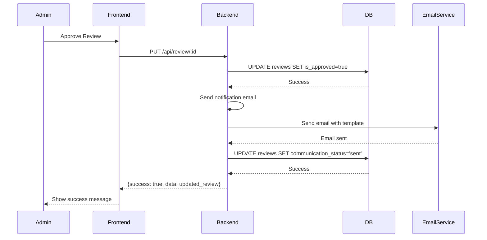

# Design Document: Admin Panel Improvements

## Overview

This design addresses multiple improvements to the admin panel of faizalamfaizi.com to enhance functionality, user experience, and workflow efficiency. The improvements span across Reviews management, Contacts management, Blog/Post creation, and Tags organization.

### Key Areas of Improvement

1. **Reviews Admin Section** - Add client communication feature when reviews are approved with predefined messages and communication status tracking
2. **Contacts Admin Section** - Add Inquiry Status and Email Status management with independent tracking
3. **Blog/Post Admin Page** - Fix Publish Date field to allow manual selection without auto-overwriting
4. **Author ID Field** - Remove manual author ID input; backend automatically assigns current admin
5. **Tags Section Improvement** - Add search, multi-select, preview, and new tag creation
6. **Tags by Category** - Organize tags with category grouping, expand/collapse, and prioritization
7. **User Experience** - Clean, wide interface with proper spacing and clear feedback
8. **Backend API Updates** - Add database fields and API endpoints for all new features
9. **Non-Breaking Implementation** - Maintain existing functionality while adding new features
10. **Testing and Quality Assurance** - Comprehensive testing for all new features

### Architecture Overview

The system follows a layered architecture:

```
┌─────────────────────────────────────────────────────────────────┐
│                        Frontend Layer                           │
│  ┌──────────────┐  ┌──────────────┐  ┌──────────────┐          │
│  │  Reviews UI  │  │  Contacts UI │  │   Posts UI   │          │
│  └──────────────┘  └──────────────┘  └──────────────┘          │
│  ┌──────────────┐  ┌──────────────┐                            │
│  │   Tags UI    │  │ Categories UI│                            │
│  └──────────────┘  └──────────────┘                            │
└─────────────────────────────────────────────────────────────────┘
                            │
                            ▼
┌─────────────────────────────────────────────────────────────────┐
│                       API Gateway Layer                         │
│  ┌──────────────────────────────────────────────────────────┐   │
│  │  Authentication | Rate Limiting | Request Validation    │   │
│  └──────────────────────────────────────────────────────────┘   │
└─────────────────────────────────────────────────────────────────┘
                            │
                            ▼
┌─────────────────────────────────────────────────────────────────┐
│                      Business Logic Layer                       │
│  ┌──────────────┐  ┌──────────────┐  ┌──────────────┐          │
│  │ReviewService │  │ContactService│  │ PostService  │          │
│  └──────────────┘  └──────────────┘  └──────────────┘          │
│  ┌──────────────┐  ┌──────────────┐                            │
│  │  TagService  │  │CategoryService│                           │
│  └──────────────┘  └──────────────┘                            │
└─────────────────────────────────────────────────────────────────┘
                            │
                            ▼
┌─────────────────────────────────────────────────────────────────┐
│                      Data Access Layer                          │
│  ┌──────────────┐  ┌──────────────┐  ┌──────────────┐          │
│  │ReviewRepo    │  │ContactRepo   │  │ PostRepo     │          │
│  └──────────────┘  └──────────────┘  └──────────────┘          │
│  ┌──────────────┐  ┌──────────────┐                            │
│  │  TagRepo     │  │CategoryRepo  │                            │
│  └──────────────┘  └──────────────┘                            │
└─────────────────────────────────────────────────────────────────┘
                            │
                            ▼
┌─────────────────────────────────────────────────────────────────┐
│                        Database Layer                           │
│  ┌──────────────┐  ┌──────────────┐  ┌──────────────┐          │
│  │  PostgreSQL  │  │  Cloudinary  │  │   Email      │          │
│  │  (Primary)   │  │  (Images)    │  │   Service    │          │
│  └──────────────┘  └──────────────┘  └──────────────┘          │
└─────────────────────────────────────────────────────────────────┘
```

## Architecture

### Component Structure

```
Admin Panel Improvements Architecture
┌─────────────────────────────────────────────────────────────────────┐
│                         Frontend Components                          │
├─────────────────────────────────────────────────────────────────────┤
│  ReviewsAdmin.jsx          ContactsAdmin.jsx         PostsAdmin.jsx  │
│  - Review list view        - Inquiry status          - Post list     │
│  - Communication panel     - Email status            - Publish date  │
│  - Message templates       - Message templates       - Author auto   │
│  - Status tracking         - Status tracking         - Tags UI       │
│                                                                      │
│  TagsManager.jsx                                                     │
│  - Search functionality                                              │
│  - Multi-select tags                                                 │
│  - Category grouping                                                 │
│  - Expand/collapse                                                   │
│  - New tag creation                                                  │
└─────────────────────────────────────────────────────────────────────┘
                            │
                            ▼
┌─────────────────────────────────────────────────────────────────────┐
│                         Backend Services                             │
├─────────────────────────────────────────────────────────────────────┤
│  ReviewService         ContactService       PostService             │
│  - Communication       - Status update      - Publish date          │
│  - Status tracking     - Email sending      - Author assignment     │
│  - Message templates   - Template selection - Tag management        │
│                                                                      │
│  TagService            CategoryService                               │
│  - Tag CRUD            - Category CRUD      - Category-tag rel      │
│  - Search              - Expand/collapse    - Prioritization        │
│  - Multi-select        - Search within cat                          │
└─────────────────────────────────────────────────────────────────────┘
                            │
                            ▼
┌─────────────────────────────────────────────────────────────────────┐
│                         Database Schema                              │
├─────────────────────────────────────────────────────────────────────┤
│  reviews (updated)          contact_inquiries (updated)             │
│  - approval_status          - inquiry_status                        │
│  - communication_status     - email_status                          │
│  - last_message_type        - email_sent_date                       │
│  - last_message_date        - last_error_message                    │
│                                                                      │
│  posts (updated)            tags (updated)                          │
│  - publish_date             - category_id (new)                     │
│  - author_id (auto)         - category_tag_rel (new)                │
│                                                                      │
│  categories (existing)                                              │
│  - name, slug, created_at                                           │
└─────────────────────────────────────────────────────────────────────┘
```

### Data Flow Diagram



## Components and Interfaces

### Frontend Components

#### ReviewsAdmin Component

**Props:**
- `token` - Admin authentication token
- `onRefresh` - Callback for refresh events

**State:**
- `reviews` - Array of all reviews
- `loading` - Loading state
- `updatingId` - ID of review being updated
- `deletingId` - ID of review being deleted
- `search` - Search query
- `approvalFilter` - Approval status filter
- `ratingFilter` - Rating filter
- `viewReview` - Currently viewed review
- `editReview` - Currently edited review
- `editForm` - Form state for editing
- `communicationModal` - Currently selected review for communication
- `selectedMessage` - Selected predefined message
- `customMessage` - Custom message text

**Methods:**
- `fetchReviews()` - Fetch all reviews from API
- `handleApprovalToggle(review)` - Toggle review approval status
- `handleDeleteReview(id)` - Delete a review
- `handleCommunicationSend()` - Send communication message
- `formatDate(date)` - Format date for display

**Sub-components:**
- `StatCard` - Statistics display
- `ReviewModal` - View/edit review details
- `CommunicationModal` - Send communication messages

#### ContactsAdmin Component

**Props:**
- `token` - Admin authentication token

**State:**
- `contacts` - Array of all contact inquiries
- `loading` - Loading state
- `updatingId` - ID of contact being updated
- `deletingId` - ID of contact being deleted
- `search` - Search query
- `inquiryStatusFilter` - Inquiry status filter
- `emailStatusFilter` - Email status filter
- `viewContact` - Currently viewed contact
- `editContact` - Currently edited contact
- `editForm` - Form state for editing

**Methods:**
- `fetchContacts()` - Fetch all contacts from API
- `handleInquiryStatusUpdate(contact, status)` - Update inquiry status
- `handleEmailStatusUpdate(contact, status)` - Update email status
- `handleEmailSend(contact)` - Send email to contact
- `formatDate(date)` - Format date for display

**Sub-components:**
- `StatCard` - Statistics display
- `ContactModal` - View/edit contact details
- `EmailModal` - Send email messages

#### PostsAdmin Component

**Props:**
- `token` - Admin authentication token

**State:**
- `posts` - Array of all posts
- `loading` - Loading state
- `deletingId` - ID of post being deleted
- `updating` - Update state
- `search` - Search query
- `statusFilter` - Status filter
- `viewPost` - Currently viewed post
- `editPost` - Currently edited post
- `editForm` - Form state for editing
- `imageFile` - Selected image file
- `imagePreview` - Image preview URL
- `tags` - All available tags
- `selectedTags` - Selected tag IDs
- `faqs` - FAQ entries
- `articleSections` - Article section entries

**Methods:**
- `fetchPosts()` - Fetch all posts from API
- `fetchTags()` - Fetch all tags from API
- `handleUpdatePost()` - Update a post
- `handleDeletePost(id)` - Delete a post
- `formatDate(date)` - Format date for display
- `toDateTimeLocal(date)` - Format date for datetime-local input

**Sub-components:**
- `StatCard` - Statistics display
- `PostModal` - View/edit post details
- `TagsManager` - Tag selection component

#### TagsManager Component

**Props:**
- `selectedTags` - Array of selected tag IDs
- `onSelect` - Callback when tag is selected
- `onDeselect` - Callback when tag is deselected
- `searchQuery` - Search query
- `selectedCategory` - Selected category ID

**State:**
- `tags` - All available tags
- `categories` - All available categories
- `expandedCategories` - Expanded category IDs
- `searchQuery` - Search query

**Methods:**
- `fetchTags()` - Fetch all tags from API
- `fetchCategories()` - Fetch all categories from API
- `toggleCategoryExpand(categoryId)` - Toggle category expansion
- `filterTags()` - Filter tags based on search and category
- `addNewTag(name)` - Add a new tag

**Sub-components:**
- `CategoryGroup` - Group of tags under a category
- `TagItem` - Individual tag display
- `SearchBox` - Search input

### Backend Services

#### ReviewService

**Methods:**
- `getAll()` - Get all reviews
- `update(id, data)` - Update a review
- `approve(id)` - Approve a review with communication
- `sendCommunication(reviewId, messageTemplate, customMessage)` - Send communication message

**Database Operations:**
- `UPDATE reviews SET is_approved = true WHERE id = ?`
- `UPDATE reviews SET communication_status = ?, last_message_type = ?, last_message_date = ? WHERE id = ?`

#### ContactService

**Methods:**
- `getAll()` - Get all contact inquiries
- `updateStatus(id, inquiryStatus, emailStatus)` - Update inquiry and email status
- `sendEmail(contactId, messageTemplate)` - Send email to contact

**Database Operations:**
- `UPDATE contact_inquiries SET status = ?, email_status = ?, updated_at = CURRENT_TIMESTAMP WHERE id = ?`
- `UPDATE contact_inquiries SET email_status = 'sent', email_sent_date = CURRENT_TIMESTAMP WHERE id = ?`
- `UPDATE contact_inquiries SET email_status = 'failed' WHERE id = ?`

#### PostService

**Methods:**
- `getAll()` - Get all posts
- `create(data)` - Create a new post
- `update(id, data)` - Update a post
- `getBySlug(slug)` - Get post by slug

**Database Operations:**
- `INSERT INTO posts (...) VALUES (...)`
- `UPDATE posts SET publish_date = ?, author_id = (SELECT id FROM users WHERE role = 'admin' LIMIT 1), ... WHERE id = ?`
- `SELECT * FROM posts WHERE slug = ?`

#### TagService

**Methods:**
- `getAll()` - Get all tags
- `create(data)` - Create a new tag
- `update(id, data)` - Update a tag
- `getByCategory(categoryId)` - Get tags by category

**Database Operations:**
- `INSERT INTO tags (name, slug, category_id) VALUES (...)`
- `UPDATE tags SET name = ?, slug = ?, category_id = ? WHERE id = ?`
- `SELECT * FROM tags WHERE category_id = ?`

#### CategoryService

**Methods:**
- `getAll()` - Get all categories
- `create(data)` - Create a new category
- `update(id, data)` - Update a category

**Database Operations:**
- `INSERT INTO categories (name, slug) VALUES (...)`
- `UPDATE categories SET name = ?, slug = ? WHERE id = ?`

## Data Models

### Review Model (Updated)

```javascript
{
  id: Number,
  name: String,
  email: String,
  message: String,
  rating: Number,
  is_approved: Boolean,
  approval_status: String,        // NEW: 'pending', 'approved', 'rejected'
  communication_status: String,   // NEW: 'email_sent', 'email_pending', 'email_failed', 'message_sent'
  last_message_type: String,      // NEW: 'review_approved', 'thank_you', 'review_published', 'custom'
  last_message_date: DateTime,    // NEW
  created_at: DateTime,
  updated_at: DateTime
}
```

### Contact Inquiry Model (Updated)

```javascript
{
  id: Number,
  name: String,
  email: String,
  subject: String,
  message: String,
  status: String,                 // EXISTING: 'new', 'read', 'responded', 'closed'
  email_status: String,           // EXISTING: 'not_sent', 'drafted', 'sent', 'failed'
  email_sent_date: DateTime,      // NEW
  last_error_message: String,     // NEW
  created_at: DateTime,
  updated_at: DateTime
}
```

### Post Model (Updated)

```javascript
{
  id: Number,
  title: String,
  slug: String,
  seo_title: String,
  meta_description: String,
  excerpt: String,
  content: String,
  featured_image: String,
  status: String,                 // 'draft', 'published', 'archived'
  category_id: Number,
  author_id: Number,              // Auto-assigned, not user input
  publish_date: DateTime,         // NEW: Manual publish date (nullable for drafts)
  published_at: DateTime,         // Existing: Auto-set when published
  created_at: DateTime,
  updated_at: DateTime
}
```

### Tag Model (Updated)

```javascript
{
  id: Number,
  name: String,
  slug: String,
  category_id: Number,            // NEW: Reference to categories table
  created_at: DateTime
}
```

### Category Model (Existing)

```javascript
{
  id: Number,
  name: String,
  slug: String,
  created_at: DateTime
}
```

### Category-Tag Relationship Model (New)

```javascript
{
  category_id: Number,            // Reference to categories table
  tag_id: Number,                 // Reference to tags table
  priority: Number,               // NEW: Priority for sorting (lower = higher priority)
  created_at: DateTime,
  PRIMARY KEY (category_id, tag_id)
}
```

## Correctness Properties

*A property is a characteristic or behavior that should hold true across all valid executions of a system-essentially, a formal statement about what the system should do. Properties serve as the bridge between human-readable specifications and machine-verifiable correctness guarantees.*

### Property 1: Communication Status Updates

*For any* review that is approved, when a communication message is sent, the review record should be updated with the message type, timestamp, and communication status, and this update should persist even if the email delivery fails.

**Validates: Requirements 1.4, 1.5**

### Property 2: Inquiry and Email Status Independence

*For any* contact inquiry, updating the inquiry status should not affect the email status, and updating the email status should not affect the inquiry status.

**Validates: Requirements 2.3**

### Property 3: Email Status Update on Send

*For any* contact inquiry, when an email is successfully sent, the email status should be updated to 'sent' and the email sent date should be recorded.

**Validates: Requirements 2.5**

### Property 4: Email Status Update on Failure

*For any* contact inquiry, when an email fails to send, the email status should be updated to 'failed'.

**Validates: Requirements 2.6**

### Property 5: Publish Date Preservation

*For any* blog post, when a specific publish date is selected, the system should preserve that date until it is manually changed by the admin.

**Validates: Requirements 3.4**

### Property 6: Draft Publish Date Nullability

*For any* draft blog post, the publish date field should accept null/empty values without validation errors.

**Validates: Requirements 3.3**

### Property 7: Author Auto-Assignment

*For any* blog post creation, if no author_id is provided in the request, the system should automatically assign the current authenticated admin user as the author.

**Validates: Requirements 4.4**

### Property 8: Author Storage Failure Prevention

*For any* blog post creation, if author storage fails due to database errors or authentication issues, the system should prevent the blog post from being created.

**Validates: Requirements 4.1, 4.2**

### Property 9: Tag Search Filtering

*For any* search query entered in the tags section, the system should return only tags whose names contain the search query.

**Validates: Requirements 5.1**

### Property 10: Multi-Select Tag Preservation

*For any* set of selected tags, when additional tags are selected, all previously selected tags should remain selected.

**Validates: Requirements 5.3**

### Property 11: Tag Removal from Preview

*For any* selected tag displayed in the preview, clicking on it should remove it from the selection.

**Validates: Requirements 5.5**

### Property 12: New Tag Creation

*For any* new tag name entered by the admin, the system should create a new tag with that name and add it to the selection.

**Validates: Requirements 5.6**

### Property 13: Category Tag Grouping

*For any* set of tags, when displayed in the tags section, tags should be grouped under their associated category headings.

**Validates: Requirements 6.1**

### Property 14: Category Expand/Collapse

*For any* category heading, clicking the expand/collapse toggle should show or hide all tags under that category.

**Validates: Requirements 6.2, 6.4, 6.5**

### Property 15: Category-Based Tag Prioritization

*For any* blog post category selected, tags associated with that category should be prioritized or highlighted in the tag selection interface.

**Validates: Requirements 6.3**

### Property 16: Category-Tag Query

*For any* category, querying tags by that category should return all tags associated with that category.

**Validates: Requirements 8.8**

### Property 17: Data Migration Preservation

*For any* existing review, contact, post, tag, or category, when schema changes are applied, the existing data should be preserved without modification.

**Validates: Requirements 9.1, 9.2, 9.3, 9.4**

### Property 18: Data Integrity Maintenance

*For any* data modification operation, the system should not modify existing data unless explicitly requested by the admin.

**Validates: Requirements 9.5**

## Error Handling

### Error Handling Strategy

The system implements a comprehensive error handling strategy that covers:

1. **Database Errors** - Connection failures, query errors, constraint violations
2. **Email Service Errors** - SMTP failures, authentication issues, network problems
3. **Authentication Errors** - Invalid tokens, expired sessions, unauthorized access
4. **Validation Errors** - Missing required fields, invalid data formats
5. **File Upload Errors** - Invalid file types, size limits, Cloudinary failures
6. **API Errors** - Network failures, timeout errors, server errors

### Error Response Format

All API errors follow a consistent format:

```json
{
  "success": false,
  "message": "Human-readable error message",
  "error": "Technical error details",
  "details": "Additional context (optional)"
}
```

### Error Handling by Component

#### ReviewsAdmin

- **Communication Send Failure**: Show error message, keep communication status as 'email_pending'
- **Update Failure**: Show error message, keep review data unchanged
- **Delete Failure**: Show error message, keep review in list

#### ContactsAdmin

- **Email Send Failure**: Update email status to 'failed', show error message
- **Status Update Failure**: Show error message, keep status unchanged
- **Delete Failure**: Show error message, keep contact in list

#### PostsAdmin

- **Publish Date Validation**: Show error if date is invalid, keep current date
- **Author Assignment Failure**: Prevent post creation, show error message
- **Image Upload Failure**: Show error message, keep existing image
- **Tag Association Failure**: Show error message, keep existing tags

#### TagsManager

- **Search Failure**: Show error message, show all tags
- **Tag Creation Failure**: Show error message, keep existing tags
- **Tag Update Failure**: Show error message, keep existing tag data

### Retry Logic

- **Email Sending**: Retry up to 3 times with exponential backoff
- **Database Operations**: Retry up to 2 times on connection failures
- **Cloudinary Upload**: Retry up to 2 times on network failures

### Logging

All errors are logged with:
- Timestamp
- Component name
- Error message
- Stack trace (for unexpected errors)
- Context data (user ID, request ID, etc.)

## Testing Strategy

### Dual Testing Approach

This feature uses a dual testing approach combining:

1. **Unit Tests** - Specific examples, edge cases, and error conditions
2. **Property Tests** - Universal properties across all inputs (where applicable)

### Property-Based Testing

Property-based testing is used for features with universal properties that hold across a wide input space:

#### Testing Libraries

- **Jest** - Unit testing framework
- **fast-check** - Property-based testing library for JavaScript
- **React Testing Library** - React component testing
- **Supertest** - API endpoint testing

#### Property Test Configuration

- Minimum 100 iterations per property test
- Each test references its design document property
- Tag format: **Feature: admin-panel-improvements, Property {number}: {property_text}**

### Unit Tests

Unit tests cover:

1. **Reviews Communication**
   - Message template selection
   - Custom message handling
   - Status update on success/failure

2. **Contacts Status Management**
   - Inquiry status updates
   - Email status updates
   - Independent status updates

3. **Posts Publish Date**
   - Date selection and preservation
   - Draft nullability
   - Future scheduling

4. **Tags Management**
   - Search filtering
   - Multi-select behavior
   - Category grouping
   - New tag creation

### Integration Tests

Integration tests cover:

1. **API Endpoints**
   - All new endpoints for reviews, contacts, posts, tags
   - Authentication and authorization
   - Error handling

2. **Database Operations**
   - Schema migrations
   - Data preservation
   - Relationship management

3. **Email Service**
   - Email sending
   - Error handling
   - Status updates

### Regression Tests

Regression tests ensure existing functionality is not broken:

1. **Reviews**
   - Existing review display
   - Existing approval workflow
   - Existing edit/delete operations

2. **Contacts**
   - Existing contact display
   - Existing inquiry workflow
   - Existing email functionality

3. **Posts**
   - Existing post display
   - Existing edit/delete operations
   - Existing tag associations

4. **Tags**
   - Existing tag display
   - Existing category associations

### Test Coverage Targets

- **Unit Tests**: 80% code coverage
- **Integration Tests**: All critical paths covered
- **Property Tests**: All universal properties tested
- **Regression Tests**: All existing functionality verified

### Test Execution

```bash
# Run all tests
npm test

# Run property-based tests
npm run test:properties

# Run unit tests
npm run test:unit

# Run integration tests
npm run test:integration

# Run with coverage
npm test -- --coverage
```

### Test Data Management

- **Test Database**: Separate test database with clean state
- **Test Users**: Pre-configured admin user for testing
- **Test Tags/Categories**: Sample data for testing relationships
- **Test Emails**: Mock email service for testing

## Error Handling

### Error Handling Strategy

The system implements a comprehensive error handling strategy that covers:

1. **Database Errors** - Connection failures, query errors, constraint violations
2. **Email Service Errors** - SMTP failures, authentication issues, network problems
3. **Authentication Errors** - Invalid tokens, expired sessions, unauthorized access
4. **Validation Errors** - Missing required fields, invalid data formats
5. **File Upload Errors** - Invalid file types, size limits, Cloudinary failures
6. **API Errors** - Network failures, timeout errors, server errors

### Error Response Format

All API errors follow a consistent format:

```json
{
  "success": false,
  "message": "Human-readable error message",
  "error": "Technical error details",
  "details": "Additional context (optional)"
}
```

### Error Handling by Component

#### ReviewsAdmin

- **Communication Send Failure**: Show error message, keep communication status as 'email_pending'
- **Update Failure**: Show error message, keep review data unchanged
- **Delete Failure**: Show error message, keep review in list

#### ContactsAdmin

- **Email Send Failure**: Update email status to 'failed', show error message
- **Status Update Failure**: Show error message, keep status unchanged
- **Delete Failure**: Show error message, keep contact in list

#### PostsAdmin

- **Publish Date Validation**: Show error if date is invalid, keep current date
- **Author Assignment Failure**: Prevent post creation, show error message
- **Image Upload Failure**: Show error message, keep existing image
- **Tag Association Failure**: Show error message, keep existing tags

#### TagsManager

- **Search Failure**: Show error message, show all tags
- **Tag Creation Failure**: Show error message, keep existing tags
- **Tag Update Failure**: Show error message, keep existing tag data

### Retry Logic

- **Email Sending**: Retry up to 3 times with exponential backoff
- **Database Operations**: Retry up to 2 times on connection failures
- **Cloudinary Upload**: Retry up to 2 times on network failures

### Logging

All errors are logged with:
- Timestamp
- Component name
- Error message
- Stack trace (for unexpected errors)
- Context data (user ID, request ID, etc.)
